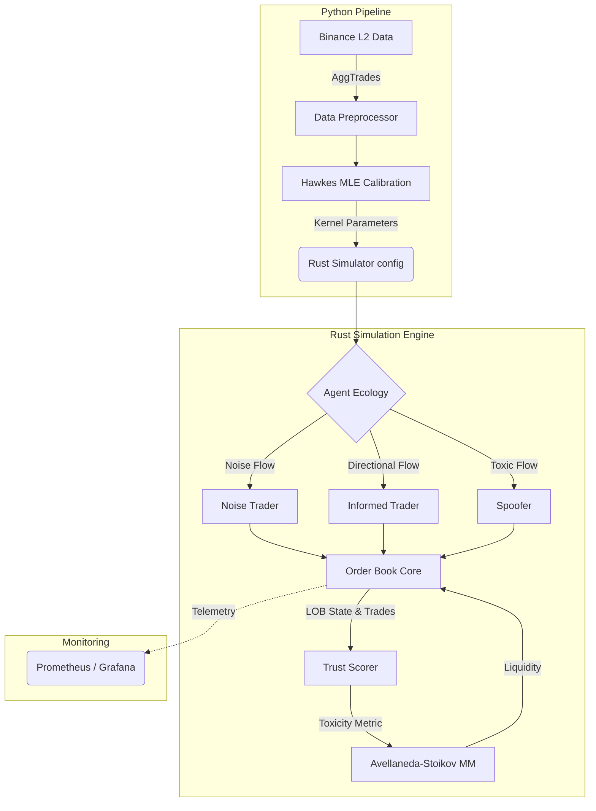

# SENTINEL

> Trust-aware adversarial market microstructure simulator & high-performance limit order book engine.

[](https://github.com/medwinjose/sentinel/actions/workflows/ci.yml)
[](https://opensource.org/licenses/Apache-2.0)
[](https://www.rust-lang.org/)
[](https://www.python.org/)

## The Problem

In modern electronic limit order books (LOBs), automated market makers (MMs) provide critical liquidity. However, this liquidity provision is constantly under attack by adversarial actors — informed traders picking off stale quotes and spoofers injecting toxic, deceptive order flow to manipulate the spread. 

Just as distributed systems must withstand Byzantine fault injections to maintain consensus, an autonomous market maker must withstand toxic order flow injections to maintain solvency. When an MM cannot discern between genuine noise and adversarial attacks, it suffers severe adverse selection, leading to catastrophic inventory accumulation or spread blowout.

## The Solution

**SENTINEL** is a comprehensive research environment for studying these adversarial market microstructures and developing robust, trust-aware liquidity provision strategies. 

It provides:
- **High-Performance LOB Core**: A strict, zero-allocation (steady state), deterministic matching engine written in Rust, achieving sub-microsecond latency.
- **Hawkes-Calibrated Noise Flow**: A Python data pipeline that calibrates multidimensional Hawkes processes from empirical Binance L2 data, projecting realistic self-exciting arrival rates into the simulator.
- **Three-Agent Ecology**: Rust agents simulating distinct market participants:
  - `NoiseTrader`: Provides the baseline background liquidity and volume.
  - `InformedTrader`: Exploits directional signals to pick off the MM.
  - `Spoofer`: Generates high-volume fleeting orders to distort the book shape.
- **Trust & Toxicity Scoring**: A real-time engine that dynamically evaluates agent behaviour (cancel ratios, quote lifetimes) to produce a `[0, 1]` trust score.
- **Trust-Aware Avellaneda-Stoikov MM**: An adaptive baseline MM that scales its risk aversion ($\gamma$) against the measured toxicity of the book, dynamically widening its spread to defend against spoofing and adverse selection.

## Architecture



## Key Results

Statistical evaluation of the trust-aware modifier across 30 seeded simulation runs demonstrates a reduction in adverse selection cost, though it was not statistically significant at the 95% confidence level under the current parameterisation.

**Ablation Study (N=30)**:
- **Mean P&L Difference**: +331,441.38 ticks
- **Mean AS Cost Difference**: -36,750.83 ticks
- **t-statistic**: -2.16
- **95% CI**: [-71613.87, -1887.79]
- **Statistically significant?**: `false`

*(Data sourced from [engine/benches/results/ablation_results.csv](engine/benches/results/ablation_results.csv))*

## Quick Start

### 1. Clone & Build
```bash
git clone https://github.com/medwinjose/sentinel.git
cd sentinel/engine
cargo build --release
```

### 2. Run Tests & Validation
```bash
cargo test --workspace
```

### 3. Run with Monitoring
To run the simulation with Prometheus metrics export enabled:
```bash
cargo run --features metrics
```
This exposes a `/metrics` endpoint on port `9100`. To view the live dashboards, bring up the monitoring stack:
```bash
cd ../monitoring
docker-compose up -d
```
Access Grafana at [http://localhost:3000](http://localhost:3000) (default login: `admin`/`admin`).

## Documentation & Papers

- [PROGRESS.md](docs/PROGRESS.md): Detailed session continuity log and implementation history.
- [STATE.md](docs/STATE.md): Current technical state and architectural decisions.
- *Research paper draft pending.*
